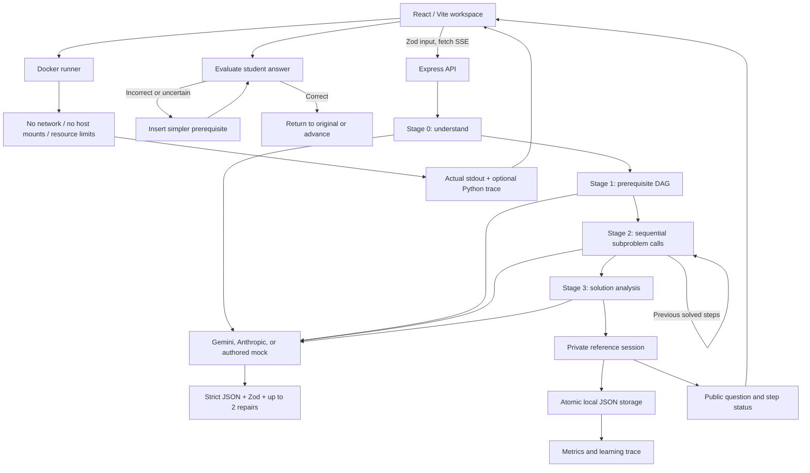

# Architecture

Full analysis responses intentionally include reference answers. Guided responses use a separate public schema and never serialize the full breakdown. Each step is evaluated only on the backend. A user's correct answer can advance without hints; the reference answer is available only at hint level 3. Full-code visibility is intentional because the learner supplied it.
